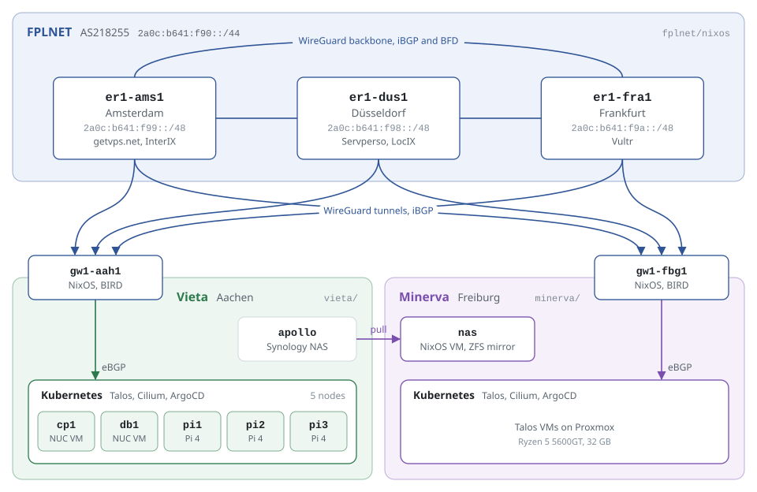
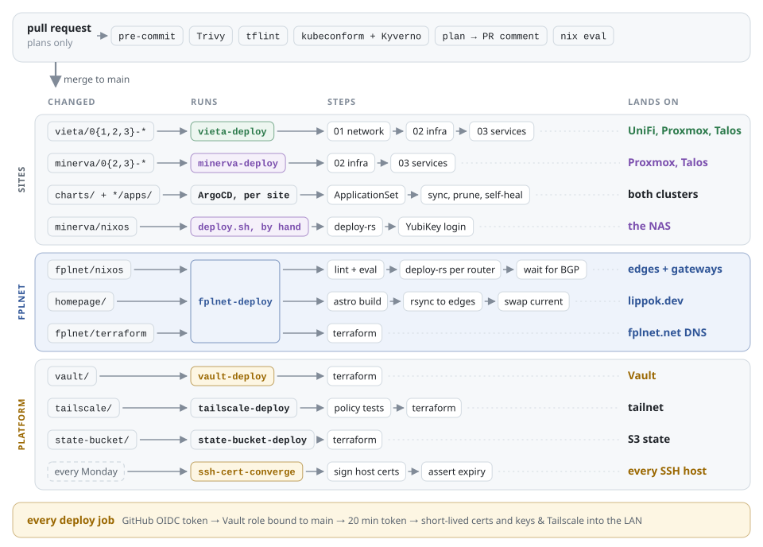
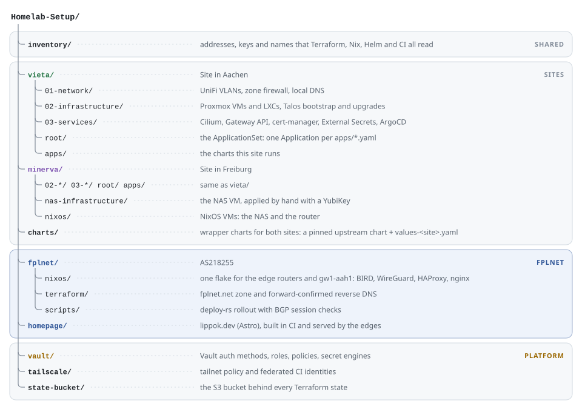
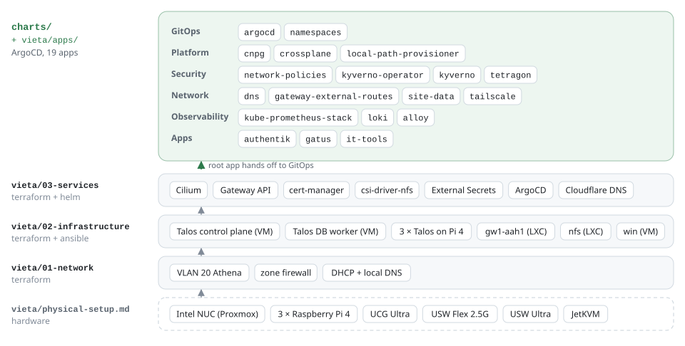
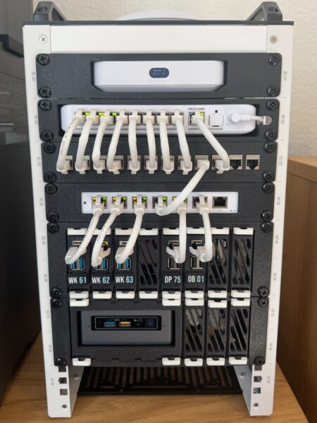
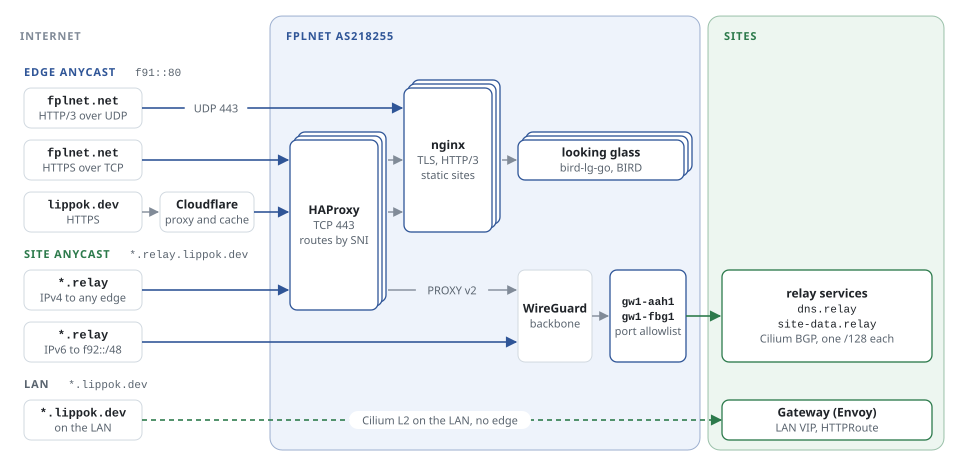
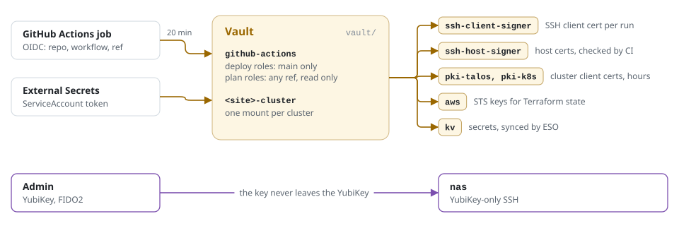

# Homelab Setup

**A three-site homelab and its own autonomous system, declared in one repo.** 
Merging to `main` is the deploy: GitHub Actions applies Terraform and NixOS, ArgoCD syncs Kubernetes.

[lippok.dev](https://lippok.dev) · [fplnet.net](https://fplnet.net) · [Looking glass](https://lg.fplnet.net) · [Status](https://lippok.dev/status) · [Hardware](vieta/physical-setup.md)

<picture>
  <source media="(prefers-color-scheme: dark)" srcset="docs/diagrams/sites-dark.svg">
  
</picture>

| Site | Runs | Code |
|:-----|:-----|:-----|
| **FPLNET** | AS218255: three BGP edge routers on a WireGuard backbone, serving lippok.dev, fplnet.net and anycast site services | `fplnet/` `homepage/` |
| **Vieta** | Kubernetes on Talos: a Proxmox NUC and three Raspberry Pis in a 10" rack, joined to the backbone by gw1-aah1 | `vieta/` `charts/` |
| **Minerva** | Kubernetes on Talos VMs and the pull-only backup NAS, on one Proxmox box, joined to the backbone by gw1-fbg1 | `minerva/` `charts/` |

## How a change ships

<picture>
  <source media="(prefers-color-scheme: dark)" srcset="docs/diagrams/delivery-dark.svg">
  
</picture>

- **Pull request:** Terraform plans arrive as PR comments and every Nix host is evaluated. `charts-validate` renders each app and runs the cluster's real Kyverno policies against it.
- **Merge:** path filters pick the workflows. Each site's deploy runs its layers in order, skips untouched ones and upgrades Talos inside `02`, node by node.
- **GitOps:** each site's `03-services` installs its own ArgoCD and one root app. From there every `<site>/apps/<chart>.yaml` is an Application that syncs, prunes and self-heals.
- **Shared charts:** both sites render the same `charts/<chart>`, with `values.yaml` as the default and `values-<site>.yaml` for the site's differences.
- **Renovate** bumps charts, images, providers, Actions and flake inputs.

## Repository

<picture>
  <source media="(prefers-color-scheme: dark)" srcset="docs/diagrams/repo-dark.svg">
  
</picture>

`inventory/check.py` checks the numbering plan on every commit; `docs/diagrams/render.py` redraws these diagrams from the inventory.

## Vieta

<picture>
  <source media="(prefers-color-scheme: dark)" srcset="docs/diagrams/stack-dark.svg">
  
</picture>

- **Talos** on Proxmox and three Pis, API only. Postgres gets its own tainted VM; everything else stores on NFS to spare the Pis' SD cards.
- **Cilium** replaces kube-proxy. It announces LoadBalancer IPs on the LAN, and pod and public service routes to gw1-aah1 over BGP. Ingress is Gateway API with a wildcard certificate.
- **Default deny** in both directions. Every allow lives in `charts/network-policies`.
- **A new service** is `charts/<name>/`, `vieta/apps/<name>.yaml` and its network policy. A database, a Vault secret and a route are one template each ([`charts/gatus/templates`](charts/gatus/templates)).
- **Rack:** a 10" mini rack, Pis powered over PoE, 3D-printed mounts; parts, layout and power in [`vieta/physical-setup.md`](vieta/physical-setup.md).
- **Planned:** a GPSDO for a stratum 1 NTP server, and a TrueNAS box replacing the NFS LXC, with democratic-csi for ZFS-backed volumes.

 

## FPLNET

<picture>
  <source media="(prefers-color-scheme: dark)" srcset="docs/diagrams/traffic-dark.svg">
  
</picture>

| Prefix | Use | Announced by |
|:-------|:----|:-------------|
| `2a0c:b641:f91::/48` | edge anycast: lippok.dev, fplnet.net, lg.fplnet.net | every edge whose health check passes |
| `2a0c:b641:f92::/48` | site anycast: `dns.relay`, `site-data.relay` | every edge holding a route from a site gateway |
| `2a0c:b641:f94::/48` | Vieta: nodes, pods, public services | every edge with iBGP to gw1-aah1 |
| `2a0c:b641:f95::/48` | Minerva: nodes, pods, public services | every edge with iBGP to gw1-fbg1 |
| `2a0c:b641:f98::/48`, `f99`, `f9a` | er1-dus1, er1-ams1, er1-fra1 | its own edge |

- **Routing:** BIRD 3, import filters after the NLNOG guide, RPKI origin validation from two Routinators, BCP 38 source filtering, receive limits on every session.
- **Rollout:** deploy-rs, one router at a time; each waits until its BGP sessions are back up.
- **Keys:** WireGuard and BGP secrets stay in Vault and reach a router right before its switch.

## Minerva

- **Hardware:** one Proxmox box: Gigabyte B450 AORUS ELITE, Ryzen 5 5600GT, 32 GB, a Broadcom SAS3008 HBA in IT mode and two 8 TB SAS drives in a ZFS mirror.
- **Cluster:** Talos VMs, its own ArgoCD, the same charts as Vieta with `values-minerva.yaml`. gw1-fbg1, a NixOS VM, joins it to the backbone.
- **NAS:** the HBA is passed to a NixOS VM, so only that VM ever imports the ZFS pool.
- **Pull-only:** nothing writes to the NAS. It pulls from Apollo and snapshots with sanoid, out of reach of ransomware on any source.
- **By hand:** the NAS is the one host deployed by hand (`minerva/nixos/deploy.sh`), and its SSH accepts two YubiKeys and nothing else.
- **Own token:** the Proxmox token Terraform uses for the rest of the site has no rights on the NAS VM. `minerva/nas-infrastructure` mints a one-hour token over a YubiKey login and revokes it when it exits.
- **Planned:** a PoE JetKVM with the ATX extension board.

## Credentials

<picture>
  <source media="(prefers-color-scheme: dark)" srcset="docs/diagrams/trust-dark.svg">
  
</picture>

- No infrastructure credential is stored in GitHub. A job trades its OIDC token for a 20-minute Vault token scoped to its workflow.
- Deploy roles are bound to `refs/heads/main`, so a pull request, which runs its own copy of a workflow, can only plan.
- SSH is certificates both ways: a throwaway key signed per run, and host certificates that `ssh-cert-converge` renews every week.

## Guardrails

| Layer | Guard |
|:------|:------|
| Admission | Kyverno in Enforce mode: Pod Security Restricted plus own rules, exceptions per workload |
| Network | Cilium default deny, ingress and egress, one chart for every allow |
| Runtime | Tetragon tracing policies, observe only |
| Edge | BCP 38 anti-spoofing, RPKI, prefix filters, receive limits |
| Repository | Trivy to the Security tab, gitleaks, shellcheck, actionlint, codespell |
| Access | SSH certificates from Vault, no static keys; the NAS takes YubiKeys only |

---

MIT (c) 2024-2026 Finn Paul Lippok. See [LICENSE](LICENSE).
